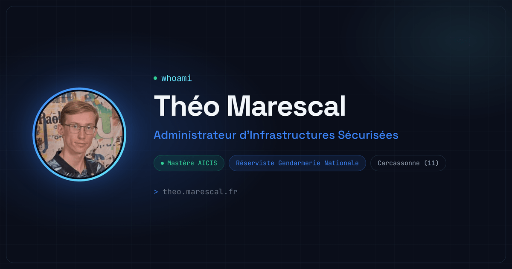

# Portfolio — Théo Marescal

Code source de mon portfolio, en ligne sur **[theo.marescal.fr](https://theo.marescal.fr)**.

Étudiant en Mastère AICIS (Architecte Infrastructures Cloud & Industries Sécurisées), titulaire du Titre Professionnel Administrateur d'Infrastructures Sécurisées et réserviste de la Gendarmerie Nationale, je présente ici mes projets, mon parcours, mes certifications et mes rapports.



## Fonctionnalités

**Site vitrine**
- Présentation, compétences, projets, formations et expériences, certifications, rapports et formulaire de contact.
- Une page détaillée par projet (contexte, méthodologie, réalisations, stack technique).
- Démos statiques jouables sur des données fictives (ex. [Memoria](https://theo.marescal.fr/demos/memoria/index.html)), qui reproduisent fidèlement les applications réelles, dont l'accès est restreint.
- Référencement : métadonnées Open Graph, données structurées Schema.org, sitemap et robots.txt générés.

**Mesure d'audience maison, respectueuse de la vie privée**
- Aucun cookie déposé chez les visiteurs, aucun service tiers d'analyse : tout est collecté et stocké sur le serveur du site (SQLite).
- Visites, pages lues, temps passé, défilement, provenance, appareils, ouvertures des documents PDF (y compris par lien direct).
- Géolocalisation approximative calculée localement (base DB-IP Lite) : aucune adresse IP n'est envoyée à un service externe.
- Bandeau d'information, [page de confidentialité](https://theo.marescal.fr/confidentialite), droit d'opposition avec effacement immédiat, signal Global Privacy Control respecté, purge automatique après 13 mois.
- Panel d'administration accessible uniquement depuis des adresses IP autorisées : statistiques détaillées, carte des visiteurs, liens de campagne, parcours par adresse IP, exclusion des appareils personnels.

## Stack

| Domaine | Technologies |
|---|---|
| Application | Next.js 15 (App Router), React 19, TypeScript strict |
| Interface | Tailwind CSS v4, Framer Motion, Lucide, Simple Icons |
| Statistiques | better-sqlite3, ua-parser-js, MaxMind DB reader + DB-IP Lite, Leaflet |
| Contact | Nodemailer |
| Déploiement | Docker (image multi-étapes, sortie `standalone`), auto-hébergé sur Raspberry Pi derrière un reverse proxy et un CDN |

## Structure

```
src/
├── app/                  Pages (accueil, projets, confidentialité, panel /admin) et routes d'API
│   └── api/              contact, collecte des visites (track), service des PDF suivis (dl)
├── components/
│   ├── sections/         Sections de la page d'accueil et page projet
│   ├── ui/               Composants réutilisables (cartes, timeline, logos…)
│   ├── analytics/        Mesure d'audience côté navigateur et bandeau d'information
│   └── admin/            Graphiques, carte et tableaux du panel
├── data/                 Contenu du site (projets, expériences, certifications, rapports…)
├── lib/                  Utilitaires, contrôle d'accès, mesure d'audience (base, géolocalisation, requêtes)
└── middleware.ts         Accès au panel et suivi des documents PDF
public/                   Images, démos statiques
```

Les documents PDF (rapports, CV, attestations) ne sont pas versionnés ici : ils sont téléchargeables directement sur le site.

## Lancer le projet

Prérequis : Docker, ou Node.js 20.

```bash
cp .env.example .env        # puis renseigner les valeurs
docker compose up -d --build
```

Le site écoute sur le port 3000 du conteneur. En développement :

```bash
npm install
npm run dev
```

Variables d'environnement : voir [`.env.example`](.env.example). La base de statistiques est créée automatiquement au premier lancement, et les bases de géolocalisation sont téléchargées puis mises à jour chaque mois.

## Droits

© Théo Marescal — tous droits réservés. Le code est publié pour consultation ; les textes, images et documents restent ma propriété.

Géolocalisation : [IP Geolocation by DB-IP](https://db-ip.com) (CC BY 4.0). Fonds de carte © [contributeurs OpenStreetMap](https://www.openstreetmap.org/copyright).
